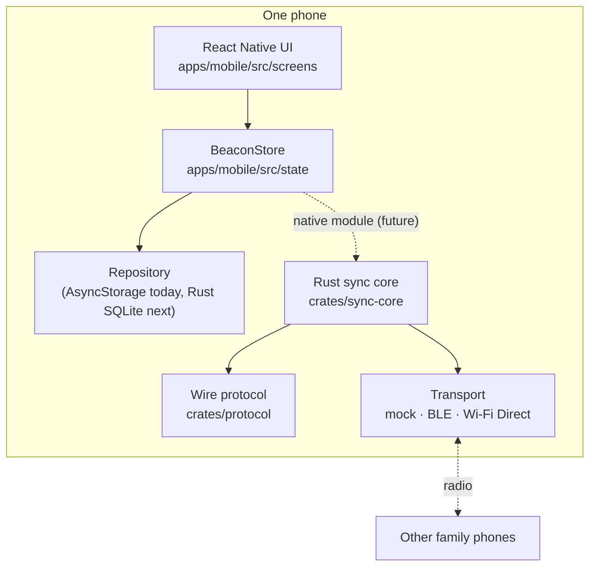

# Architecture

Family Beacon is a local-first app. Each phone holds its own copy of the family's data and swaps
updates directly with other family phones when they are near each other. No server takes part
in normal operation.

## Layers

| Layer | Lives in | Responsibility |
| --- | --- | --- |
| Screens | `apps/mobile/src/screens` | Render state, call store actions. No storage or radio code. |
| Store | `apps/mobile/src/state/beaconStore.ts` | One source of truth for the UI. Turns actions into envelopes. |
| Repository | `apps/mobile/src/data/` | The only code that touches local storage. `StorageRepository` on device, `MemoryRepository` in tests. |
| Crypto | `crates/crypto` | Signatures, sealing for a group or one person, route tags, padding. Pure functions. |
| Protocol | `crates/protocol` | Scopes, envelopes (readable and sealed), messages, membership certificates. Codec. Validation. No I/O. |
| Sync core | `crates/sync-core` | Sealing, neighborhoods, tiered queueing, conflict rules, sessions, scheduling, transports. |
| Transports | `crates/sync-core/src/transport` | Move opaque byte frames to nearby peers. |

## Today's bridge: the TypeScript mirror

The Rust core is the long-term owner of sync logic. It is not yet compiled into the mobile app.
That needs a native module, most likely generated with [UniFFI](https://mozilla.github.io/uniffi-rs/)
and exposed as a React Native Turbo Module. Until then, `apps/mobile/src/sync/` holds a small
TypeScript mirror:

- `protocol.ts` mirrors `crates/protocol` field for field, with the same JSON tags.
- `householdView.ts` and `neighborhoodView.ts` mirror the rules in `conflict.rs`, `neighborhood.rs` and `feed.rs`. The mirror decides readability by audience; it does not encrypt.
- `mockTransport.ts` simulates nearby family phones.

`fixtures/sample-household.json` is the contract between the two. A Rust integration test
(`crates/protocol/tests/sample_fixture.rs`) decodes and validates it, and the app loads it as
sample data. A protocol change that breaks the fixture fails `cargo test`.

**Bridging plan (first real product slice):**

1. Add a `crates/ffi` crate that wraps `SyncEngine` with UniFFI.
2. Build it for `aarch64-apple-ios`, `aarch64-apple-ios-sim`, and the Android ABIs (via
   `cargo-ndk`). Link it from the iOS and Android projects.
3. Swap `BeaconStore.record` and `exchange` to call the native engine. The screens don't change.
4. Delete the TypeScript mirror, keeping only the types.

## Data model

All state is derived from **envelopes**: immutable, uniquely identified updates. See
[sync-protocol.md](sync-protocol.md).

| Concept | Type | Notes |
| --- | --- | --- |
| Person / trusted contact | `Person` | `adult`, `child`, or `caregiver`. Public key slot for identity. |
| Household / trusted circle | `Household` | The trust boundary. Envelopes from outside are rejected. |
| Check-in status | `CheckIn` | `safe`, `on_my_way`, `at_rendezvous`, `need_help`, plus an optional note. |
| Rendezvous point | `RendezvousPoint` | Ranked meeting places with plain-language directions. |
| Local message envelope | `Envelope` | Wraps one payload, with Lamport time, expiry, hop count, and signature. |
| Sync session | `SyncSession` | One encounter with one peer: hello, deliver, done. |
| Transport | `Transport` trait | Byte frames to and from nearby peers. |

Storage schema: `crates/sync-core/migrations/0001_init.sql` and `0002_scopes.sql`, applied by
`SqliteStore` (`crates/sync-core/src/sqlite_store.rs`).

## Offline-first guarantees

The app must keep working, with no loss of function, when:

- **cellular service is unavailable**: no feature depends on it.
- **the internet is unavailable**: nothing calls the network. `INTERNET` permission on Android
  exists only so debug builds can reach Metro.
- **cloud services are unavailable**: there are none in the critical path, and none in this
  repo at all.

Concretely:

- Every action is saved locally first and shown right away. Sharing happens later, whenever a
  family phone is in range.
- There is no "sending..." state that can fail. An update is either on this phone (it always
  is) or also on other phones (eventually).
- Data stays on the device by default. There is no account, telemetry, or analytics.

## Battery

Battery life is a product requirement:

- The engine has **no background thread and no async runtime**. The OS wakes the app for a BLE
  event or a scheduled task, and the app calls `sync_round()` once.
- `SyncSchedule` backs off exponentially, from 30 s up to 15 min, while nobody is around. It
  snaps back after a local change or a successful exchange.
- Peers synced recently are skipped for a cooldown unless we have something new for them.
- Each session sends at most a bounded number of envelopes, so a backlog can't hold the radio
  open.
- BLE does discovery and small payloads. Wi-Fi Direct is only for bulk catch-up. See
  [transports.md](transports.md).

## Neighborhood networks (planned)

Growing from one household to neighborhood scale, with household, neighborhood and direct
scopes, sealed relay by any phone, and invitation chains, is designed in
[neighborhood-network.md](neighborhood-network.md).

## Optional relay (future, not in this repo)

A relay could later carry envelopes between households that are far apart, or provide an admin
view for community coordinators. If it is ever built, it must stay optional, see only encrypted
envelopes, and live in its own `services/relay` directory. Nothing in the apps or crates may
depend on it.
