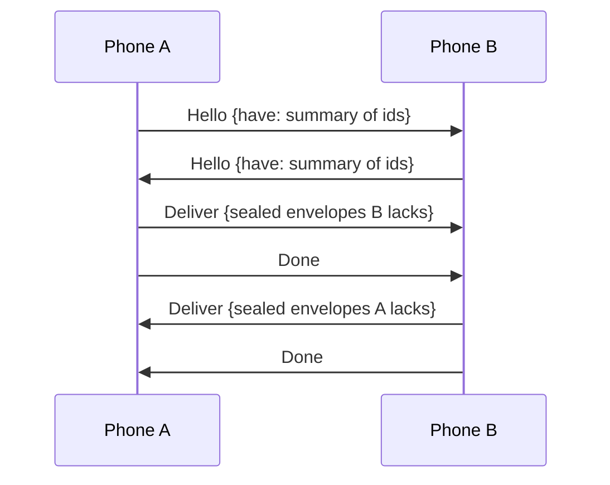

# Sync protocol: store-and-forward (protocol v2)

Neighborhood-scale design and its rationale: [neighborhood-network.md](neighborhood-network.md).

## Envelopes: readable inside, sealed outside

Every change (a check-in, a neighborhood alert, a private message) becomes one immutable
**envelope**. Only its audience ever sees the readable form:

```jsonc
{
  "version": 2,
  "id": "uuid",                       // unique, so duplicates are harmless
  "audience": { "scope": "household", "household_id": "uuid" },
  //          { "scope": "neighborhood", "neighborhood_id": "uuid" }
  //          { "scope": "direct", "recipient": "person uuid" }
  "author": "uuid",
  "origin_device": "uuid",
  "created_at": 1767225000000,        // author's wall clock (a hint, not an order)
  "lamport": 6,                       // causal order that doesn't trust clocks
  "expires_at": 1767397800000,        // dropped everywhere after this
  "payload": { "type": "check_in", "data": { ... } },
  "signature": "base64"               // Ed25519, by the author
}
```

Before it leaves the device, it's sealed. This is what every phone sees and carries:

```jsonc
{
  "version": 2,
  "id": "uuid",                       // same id, for mesh-wide de-duplication
  "scope": "household",               // household | neighborhood | direct
  "route_tag": "base64",              // lets the audience recognize it; random to everyone else
  "expires_at": 1767397800000,
  "hops_remaining": 12,               // decremented by each relay
  "priority_class": "normal",         // low | normal | urgent
  "body": "base64"                    // encrypted, padded to 512 B / 1 KB / 4 KB
}
```

**Any** Family Beacon phone relays sealed envelopes, so updates travel with everyone who has
the app. A phone opens only what it holds keys for: its household's, its neighborhoods', and
direct messages addressed to its person.

| Payload | Scope | TTL | Priority |
| --- | --- | --- | --- |
| `check_in` (`need_help`) | household | 2 days | Urgent: sent first, evicted last |
| `check_in`, `note` | household | 2 days | High / Low |
| `rendezvous_upsert` / `_remove` | household | 90 days | Normal |
| `alert` (`medical`, `fire`) | neighborhood | 1 day | Urgent |
| `alert` (other), `offer`, `need`, `household_status`, `withdraw` | neighborhood | 1 day | High to Low |
| `member_joined`, `member_removed`, `steward_added` | neighborhood | 365 days | Normal / High |
| `message`, `wellness_request`, `wellness_reply` | direct | 2 days | Normal / High (Urgent if replying "need help") |
| `key_rotation` | direct | 30 days | High |

A payload may only travel in its own scope: a family check-in can never be sent to the
neighborhood.

## A sync session

When **any** two Family Beacon phones come into range, each side does this without waiting
on the other:



- There are no request/response round trips. Links between people walking past each other may
  last only seconds.
- The `have` summary is the exact id list when a phone holds 64 or fewer envelopes, and a 1%
  Bloom filter above that (about 1.2 bytes per id). A false positive delays one envelope until
  the next meeting; each `Hello` uses a fresh seed.
- Only an unknown protocol version gets a `Reject`. Phones from different households still sync:
  they relay each other's sealed traffic.
- Deliveries are split into frames that fit the transport's limit (`pack_deliveries`).
- A session that stalls for 2 minutes is dropped. The next encounter starts fresh.

## Receiving

For each sealed envelope:

1. **Header checks**: version, expiry, size. Malformed envelopes are dropped.
2. **Already held?** It's a duplicate; skip it.
3. **Is it ours?** Compare the route tag against each key this phone holds.
   - **Yes:** open it, then check scope, audience, membership, timestamps and size
     (`validate_envelope`), the author's signature, and rate limits. If everything passes,
     store it, fold it into the views, and queue a copy to pass on. Direct messages that
     reached their recipient aren't passed on. A false "urgent" claim in the header is
     downgraded for the next hop.
   - **No:** if relaying is on (the default), store it unread and queue it in the relay tier.

## Outbound queue and budgets

The `OutboundQueue` holds what this phone is willing to pass on, in tiers with separate
budgets, so neighborhood traffic can never crowd out your own family:

| Tier | Entries | Storage | Per encounter |
| --- | --- | --- | --- |
| Household | 500 | 2 MB | 200 |
| Neighborhood | 2,000 | 4 MB | 100 |
| Direct | 200 | 1 MB | 50 |
| Relay (others) | 1,000 | 2 MB | 100 |

Send order: anything urgent, then household, direct, neighborhood, relay. Within a tier,
higher priority goes first, then oldest first. When a tier is full, its lowest-priority, oldest
envelope is evicted, and only if the newcomer is worth more.

## Conflict handling

Phones receive envelopes late, out of order, and twice. Every view is a deterministic fold, so
**every phone with the same envelopes shows the same thing**:

- **Check-ins: latest event wins, per person.** Ordered by reported time, then Lamport, then
  envelope id. Handles one person with two phones and a parent checking in for a child.
- **Meeting points: last writer wins, per point.** Ordered by Lamport, then time, then id. An
  informed edit always beats a stale one. Removal leaves a tombstone, so an old copy can't bring
  a point back.
- **Notes and posts are append-only.** Newest first. Authors can withdraw their own posts.
- **Neighborhood rosters are recomputed from all membership events**: invite chains from the
  founder, stewards appointed by the founder, and removals by stewards (see
  `neighborhood.rs`).

## Wire encoding

JSON, with bytes as base64, for easy debugging and inspection from JS. Every encode and decode
goes through `crates/protocol/src/codec.rs`, so moving BLE to a compact binary format (CBOR or
postcard) is a one-file change gated by `PROTOCOL_VERSION`.
